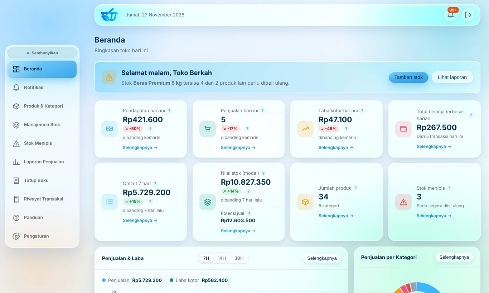
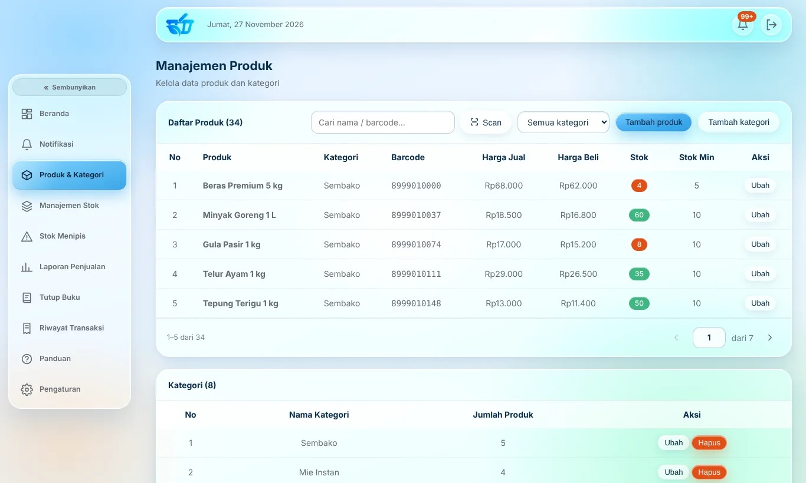
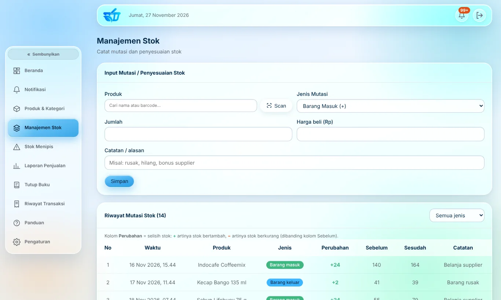
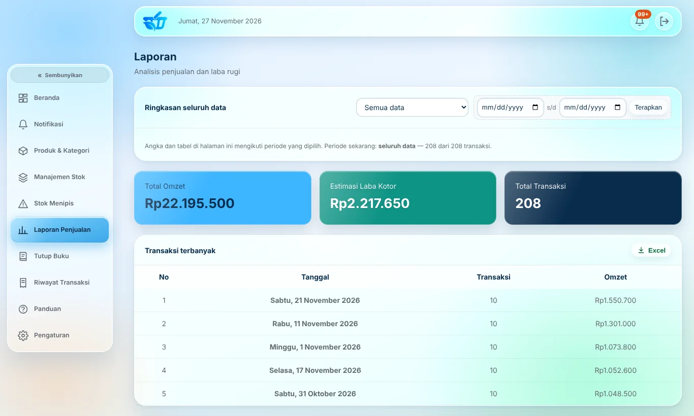
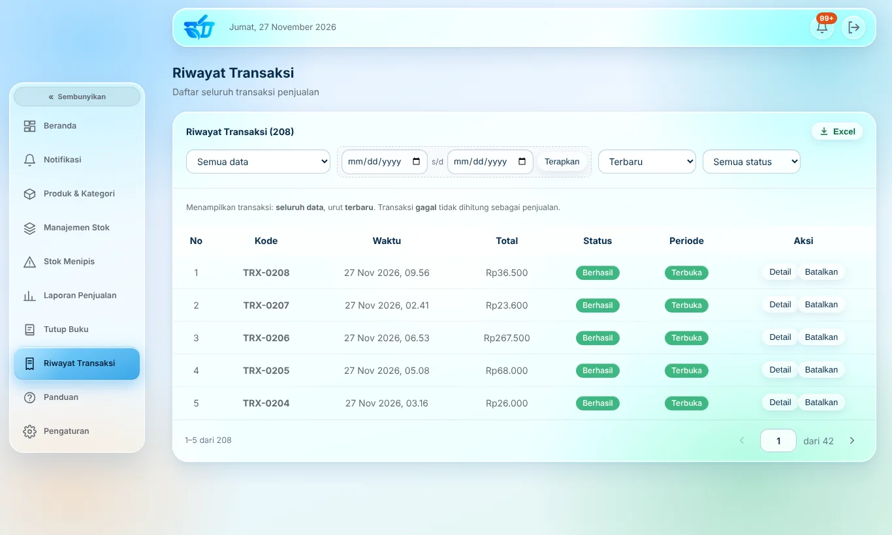
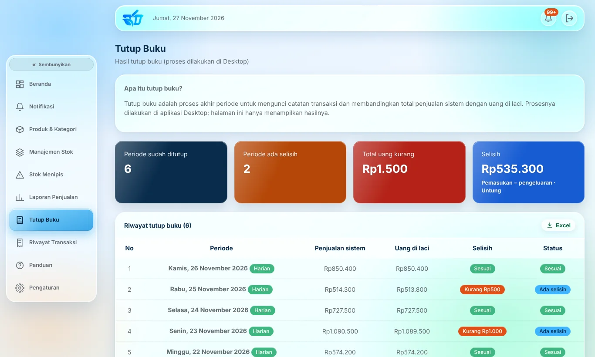
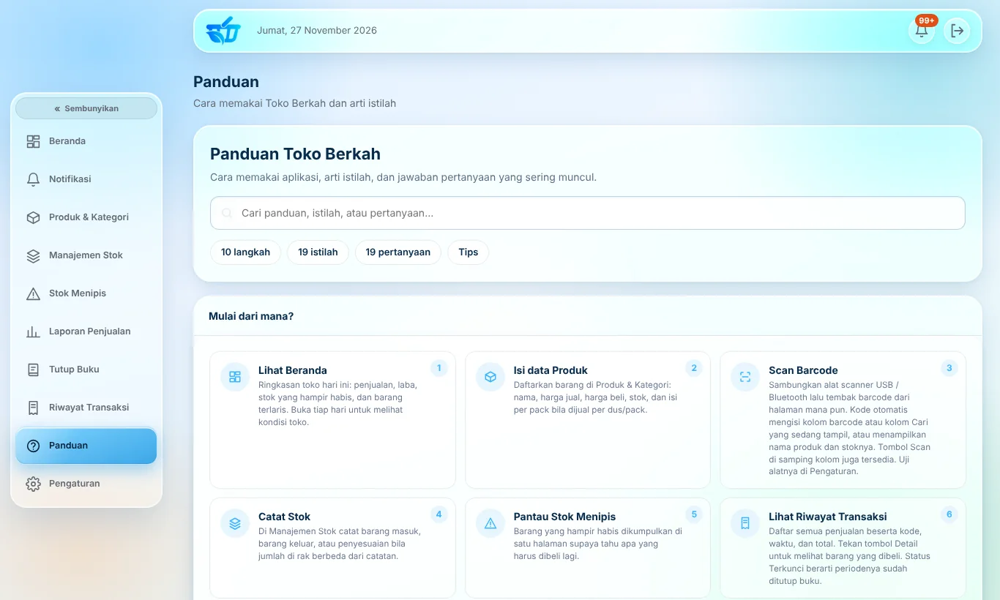
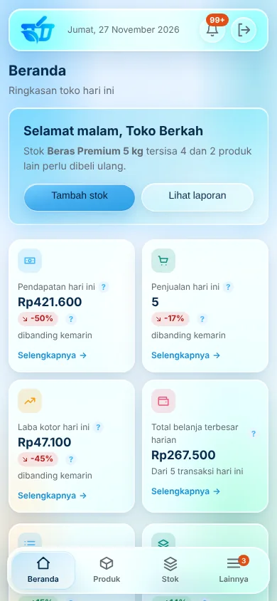
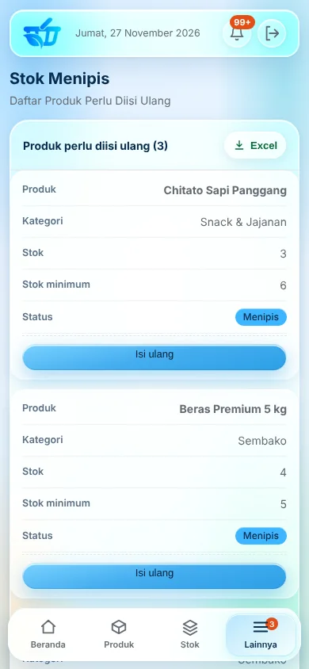

<div align="center">


# Toko Berkah

**Sistem manajemen barang & stok untuk toko kelontong** — Web, Desktop, dan Android,
satu database, satu sumber kebenaran.

[](https://nasrulaja.github.io/toko-berkah-project/)
[](#-backend--database)
[](Toko-Berkah-Dekstop/README.md)
[](#-versi-android)

[Coba Web](https://nasrulaja.github.io/toko-berkah-project/) ·
[Unduh Desktop](Kasir-Demo.zip) ·
[APK Android](demo/android/) ·
[Backend](backend/README.md) ·
[Dokumentasi](#-peta-dokumentasi)

</div>

---

## ✨ Sekilas

<table>
<tr>
<td width="33%" valign="top">

### 🌐 Web
Untuk **pemilik toko**: produk & kategori, stok, laporan penjualan, riwayat transaksi, dan hasil tutup buku. Tampilan *liquid glass*, responsif di HP, **scan barcode dengan alat scanner**, dan unduh Excel.

</td>
<td width="33%" valign="top">

### 🖥️ Desktop
Untuk **kasir**: input barcode, keranjang, kembalian otomatis, struk, dan **tutup kasir**. Tetap jalan saat internet mati, lalu **sinkron otomatis** ke Supabase.

</td>
<td width="33%" valign="top">

### 📱 Android
Untuk **pemilik**: cek harga, ubah harga + riwayat, cek stok, dan barang masuk — dengan **pemindai barcode kamera**.

</td>
</tr>
</table>

Semua tersambung ke **satu database Supabase**, jadi penjualan di kasir langsung muncul di
web, dan stok yang diubah di web langsung terlihat di aplikasi lain.

```
Desktop kasir ──┐
Web ────────────┼──▶  Supabase (PostgreSQL)  ◀── backend REST (opsional)
Android ────────┘
```

## 📸 Tampilan Web

<p align="center">
  
  
</p>
<p align="center">
  
  
</p>
<p align="center">
  
  
</p>
<p align="center">
  
  
  
</p>

<sub>Data pada tangkapan layar adalah data contoh. Tangkapan layar aplikasi Android ada di [`docs/DEMO-ANDROID.md`](docs/DEMO-ANDROID.md).</sub>

## 🚀 Mulai Cepat

| Saya ingin… | Lakukan ini |
|---|---|
| **Mencoba web** | Buka [demo web](https://nasrulaja.github.io/toko-berkah-project/), login `berkah@gmail.com` / `berkah123` |
| **Mencoba kasir Desktop** | Unduh [`Kasir-Demo.zip`](Kasir-Demo.zip), **ekstrak**, jalankan `Kasir.exe` (login `kasir@gmail.com` / `kasir123`) |
| **Mencoba Android** | Pasang APK dari [`demo/android/`](demo/android/) |
| **Menjalankan web di komputer sendiri** | `python3 -m http.server 8000` di folder repo, buka `http://localhost:8000` |
| **Membuat ulang database** | Jalankan [`database_toko_berkah_lengkap.sql`](database_toko_berkah_lengkap.sql) di Supabase → SQL Editor |

## 📦 Daftar Platform

| Platform | Status | Teknologi | Lokasi |
|---|---|---|---|
| **Web** | ✅ Tersedia | HTML + CSS + JS (ES Module, tanpa build), data dari Supabase | root repo (`index.html`, `js/`, `css/`) |
| **Desktop** | ✅ Tersedia | C# WinForms (.NET 8) + SQLite, sinkron ke Supabase | `Toko-Berkah-Dekstop/` |
| **Android** | ✅ Kode sumber + APK | Kotlin (2 modul Gradle: `app`, `pages`), CameraX + ML Kit, Supabase REST | kode: `TokoBerkah-Android-App/`, APK: `demo/android/` |
| **Backend** | ⚙️ Opsional | Node.js + Express → Supabase | `backend/` (+ `render.yaml` untuk Render) |
| **Database** | 🗄️ Skema + data contoh | PostgreSQL / Supabase | `database_toko_berkah_lengkap.sql` |

**Paket siap pakai (APK Android, aplikasi Desktop) ada di [`demo/`](demo/), dan zip Desktop juga ada di root: [`Kasir-Demo.zip`](Kasir-Demo.zip).**

---

## 🖥️ Versi Desktop (Windows)

Aplikasi kasir native. **Full bahasa Indonesia** (Surel / Kata Sandi). Detail
lengkap ada di [`Toko-Berkah-Dekstop/README.md`](Toko-Berkah-Dekstop/README.md).

- **Teknologi:** C# WinForms (.NET 8) + SQLite (`Microsoft.Data.Sqlite`), ekspor laporan via ClosedXML
- **Fitur:** input barcode, keranjang, kembalian otomatis, struk, stok berkurang otomatis, kelola produk (hanya-baca untuk kasir), tutup kasir, laporan harian/bulanan + ekspor Excel, dan **sinkron otomatis ke Supabase** (data muncul di web)

### Cara tercepat mencoba (tanpa build)

| Untuk | Ambil ini | Cara pakai |
|---|---|---|
| **Paling mudah** | [`Kasir-Demo.zip`](https://github.com/nasrulaja/toko-berkah-project/raw/main/Kasir-Demo.zip) | Unduh, ekstrak, jalankan `Kasir.exe` |
| **Tanpa zip** | folder [`demo/desktop/Kasir/`](demo/desktop/Kasir/) | Unduh seluruh isi folder, lalu jalankan `Kasir.exe` |

> Wajib **diekstrak dulu**. Jangan jalankan `Kasir.exe` dari dalam ZIP: aplikasi tidak akan menemukan file pendampingnya dan langsung error.

Syarat: Windows 64-bit + [.NET 8 Runtime (Desktop)](https://dotnet.microsoft.com/download/dotnet/8.0).

Yang bisa dicoba: login kasir, cari barang lewat barcode, keranjang, bayar + kembalian, struk, laporan harian/bulanan (ekspor Excel), tutup kasir, dan **sinkron otomatis ke database web** (bilah status hijau di bawah jendela). Bila internet mati, transaksi tetap tersimpan dan terkirim sendiri saat online kembali.

### Login desktop
- Surel: `kasir@gmail.com`
- Kata sandi: `kasir123`

### Menjalankan (butuh .NET 8 SDK)
```bash
cd Toko-Berkah-Dekstop/Kasir
dotnet run
```

### Membuat .exe mandiri (tanpa perlu install .NET di PC tujuan)
```bash
cd Toko-Berkah-Dekstop/Kasir
dotnet publish -c Release -r win-x64 --self-contained true ^
  -p:PublishSingleFile=true -p:IncludeNativeLibrariesForSelfExtract=true
```

### Catatan penting desktop
- Database `kasir.db` dibuat otomatis **di samping `Kasir.exe`**. Backup file ini kalau data penting.
- Hapus `kasir.db` untuk reset ke data awal.
- Kata sandi disimpan ter-hash (PBKDF2-SHA256), bukan teks polos.

---

## 🌐 Versi Web

Aplikasi web untuk **pemilik / pengelola toko**: mengelola produk dan stok, melihat
laporan penjualan, riwayat transaksi, dan hasil tutup buku. Kasir/POS **tidak ada di
web**; transaksi dicatat lewat aplikasi Desktop lalu otomatis muncul di web.

**Demo hosting:** https://nasrulaja.github.io/toko-berkah-project/
*(Perlu internet: data diambil langsung dari Supabase dan font dari Google Fonts.)*

### Menjalankan lokal
1. Clone atau download repo ini
2. Jalankan server statis di folder proyek, mis. `python3 -m http.server 8000` (atau `npx serve`)
3. Buka `http://localhost:8000` di browser (Chrome/Firefox/Edge terbaru)
4. Login dengan akun demo di bawah

> Jangan membuka `index.html` langsung lewat `file://`: aplikasi memakai ES module (`type="module"`)
> yang diblokir browser untuk file lokal, sehingga halaman tampil kosong.

### Login demo web
- Surel: `berkah@gmail.com`
- Kata sandi: `berkah123`

### Halaman & fitur

| Menu | Isi |
|---|---|
| **Beranda** | Ringkasan hari ini (pendapatan, penjualan, laba, stok menipis), grafik, produk terlaris, jam/hari tersibuk. Tiap kartu punya tombol *Selengkapnya* yang membuka halaman sesuai filter kartunya |
| **Notifikasi** | Aktivitas toko (penjualan, stok, tutup buku) dengan filter, pencarian, dan status dibaca |
| **Produk & Kategori** | Tambah/ubah/hapus produk dan kategori, harga jual & beli, stok, isi per pack. Nama dan barcode dikunci saat ubah |
| **Manajemen Stok** | Barang masuk, barang keluar, dan penyesuaian stok + riwayat mutasi (pencarian produk lewat nama atau barcode) |
| **Stok Menipis** | Produk yang stoknya ≤ stok minimum, dengan tombol *Isi ulang* |
| **Laporan Penjualan** | Omzet, laba, produk terlaris, belanja terbesar per periode (hari ini, 7/30 hari, bulan tertentu, tahun ini, semua) |
| **Tutup Buku** | Hanya **menampilkan** hasil tutup buku (prosesnya di Desktop): periode, selisih uang laci, riwayat |
| **Riwayat Transaksi** | Semua transaksi dengan detail barang dan status (berhasil / gagal / terkunci) |
| **Panduan** | Langkah memakai aplikasi, arti istilah, dan tanya jawab, dengan kolom cari |
| **Pengaturan** | Profil, uji alat scanner & bunyi scan, status database + muat ulang data + cadangan Excel, sakelar notifikasi, versi aplikasi |

Fitur lintas halaman:
- **Scan barcode dengan alat scanner fisik (USB/Bluetooth)** — scanner bekerja seperti keyboard; tembak dari halaman mana pun, kode mengisi kolom barcode/cari yang tampil. Tombol *Scan* ada di form Tambah Produk dan kolom pencarian. Tanpa kamera.
- **Unduh Excel** (`.xls`, angka tersimpan sebagai angka) di Riwayat Transaksi, Laporan, Stok Menipis, dan Tutup Buku; cadangan Produk/Transaksi/Mutasi di Pengaturan.
- **Liquid glass** — tampilan kaca bening dengan latar aurora; rail kaca di desktop, menu bawah di HP.
- **Responsif** — tabel berubah menjadi kartu di HP.
- **Animasi** — layar sambutan 3D, transisi login → beranda dan antar halaman.
- **Bahasa Indonesia penuh.**

### Sumber data
Semua data dibaca dan ditulis langsung ke **Supabase** (REST/PostgREST). Tidak ada data
toko di `localStorage` dan tidak ada data contoh di kode. Bila database tidak terjangkau,
web menampilkan layar galat, bukan data palsu. Penyimpanan terjadi per perubahan dan hasilnya
(berhasil/gagal) langsung ditampilkan.

Catatan perilaku:
- Harga beli dibaca dari `produk.harga_beli` (dengan cadangan dari `stok_mutasi.harga_kulak`).
- Kolom `isi_pack` belum ada di database, jadi isi per pack selalu 1.
- Transaksi berstatus `gagal` tampil di riwayat tetapi tidak dihitung pada omzet, laba, grafik, maupun notifikasi.

### Struktur kode web

> Setiap berkas diawali banner **PETA FILE** dan dibagi dengan penanda
> `BAGIAN n — NAMA`. Cukup cari teks `BAGIAN` di editor untuk melompat
> antar bagian tanpa perlu membaca seluruh berkas.

- **`index.html`** — Kerangka halaman (`#app`, `#ov`), pemuatan font/CSS, layar sambutan 3D (inline, gambar di `assets/splash/`), dan pemanggilan skrip.
- **`js/app.js`** — Titik masuk: daftar halaman & menu, routing hash URL, animasi pindah halaman, event binding utama, panggilan scanner global.
- **`js/pages.js`** — Render seluruh halaman (Beranda, Produk, Stok, Stok Menipis, Laporan, Tutup Buku, Transaksi, Notifikasi, Panduan, Pengaturan, Login).
- **`js/ui.js`** — Utilitas DOM, format Rupiah & tanggal, toast, modal, escape HTML, ikon SVG.
- **`js/charts.js`** — Grafik dashboard/laporan.
- **`js/glass-rail.js`** — Rail vertikal desktop dengan fisika *spring*.
- **`js/core/api.js`** — Klien Supabase (REST): memuat semua tabel dan menyimpan perubahan (kategori → produk → mutasi stok), alamat & kunci publik project.
- **`js/core/db.js`** — Keadaan data di memori (`load`, `save`, `mut`) dan status sambungan.
- **`js/core/excel.js`** — Pembuat berkas Excel `.xls` (SpreadsheetML) tanpa pustaka luar.
- **`js/core/scan.js`** — Pendengar alat scanner fisik dan jendela Scan.
- **`css/style.css`** · **`glass.css`** · **`light.css`** · **`mobile.css`** · **`login.css`** · **`transisi.css`** · **`loader.css`** · **`scan.css`** · **`panduan.css`** · **`pages/dashboard.css`** — gaya dasar, kaca, tema terang (dimuat paling akhir), HP, login, animasi, dan tiap halaman.

### Catatan teknis web
- Tidak ada build process — cukup server statis.
- Nomor versi di `?v=…` pada tautan CSS/JS adalah pemecah cache; **naikkan saat merilis** dan pastikan semua impor modul yang sama memakai nomor yang sama.
- Kunci Supabase yang dipakai adalah *publishable key* yang dibatasi Row Level Security.

---

## 📱 Versi Android

Aplikasi Android **native untuk pemilik toko**: cek harga, ubah harga, cek stok, dan
barang masuk dari HP, terhubung langsung ke **Supabase** (REST, tanpa server perantara).
Kode sumber ada di [`TokoBerkah-Android-App/`](TokoBerkah-Android-App/).

Halaman yang ada di kode:
- **Login** dan **Cek Stok**
- **Cek Harga** — daftar produk (dengan kategori) dan detail produk
- **Ubah Harga** dan **Riwayat Harga**
- **Barang Masuk**
- **Terakhir Dilihat**
- **Pemindai barcode** — CameraX + ML Kit

Teknologi: Kotlin · dua modul Gradle (`:app`, `:pages`) · AndroidX · CameraX + ML Kit Barcode ·
Supabase PostgREST · minSdk 24.

### Membuka & membangun
Buka folder `TokoBerkah-Android-App/` di Android Studio, tunggu sinkronisasi Gradle, lalu jalankan
modul `app`. (Pemindaian dengan kamera hanya ada di aplikasi Android; versi web memakai alat scanner fisik.)

### Login mobile
- Surel: `kasir@gmail.com`
- Kata sandi: `kasir123`

### APK siap pasang

Semua APK ada di **[`demo/android/`](demo/android/)**.

| Jenis | Arsitektur | APK | Ukuran |
| --- | --- | --- | --- |
| **Disarankan** (langsung bisa dipasang) | arm64-v8a | [`…-arm64-v8a-debug.apk`](demo/android/TokoBerkah-Owner-arm64-v8a-debug.apk) | 27 MB |
| debug | armeabi-v7a | [`…-armeabi-v7a-debug.apk`](demo/android/TokoBerkah-Owner-armeabi-v7a-debug.apk) | 25 MB |
| kecil, perlu ditandatangani | arm64-v8a | [`…-arm64-v8a-release-unsigned.apk`](demo/android/TokoBerkah-Owner-arm64-v8a-release-unsigned.apk) | **8.1 MB** |
| kecil, perlu ditandatangani | armeabi-v7a | [`…-armeabi-v7a-release-unsigned.apk`](demo/android/TokoBerkah-Owner-armeabi-v7a-release-unsigned.apk) | **6.5 MB** |

APK **debug** sudah bertanda tangan jadi bisa langsung dipasang. APK **release**
jauh lebih kecil tetapi masih *unsigned* — tanda tangani dulu sebelum dipasang.
APK di folder ini dibuat sebelum perubahan terbaru pada kode sumber, jadi bisa berbeda dari kode terkini.

> Tangkapan layar & alur demo Android: [`docs/DEMO-ANDROID.md`](docs/DEMO-ANDROID.md).

---

## 🖧 Backend & Database

- **[`backend/`](backend/README.md)** — server REST (Node.js + Express) di atas Supabase: login (JWT), produk, kategori, stok, transaksi, tutup buku. Opsional; web, desktop, dan Android sudah bisa langsung ke Supabase. Siap dideploy ke Render lewat `render.yaml` (isi `SUPABASE_SERVICE_ROLE_KEY` di dashboard, **jangan** disimpan di repo atau aplikasi klien).
- **[`database_toko_berkah_lengkap.sql`](database_toko_berkah_lengkap.sql)** — membuat ulang database: skema 10 tabel (`roles`, `users`, `kategori`, `produk`, `rekap_penjualan`, `transaksi`, `struk`, `detail_transaksi`, `stok_mutasi`, `tutup_buku`), RLS, 15 kategori, 300 produk, akun demo, dan data transaksi contoh. Jalankan di Supabase → SQL Editor.

---

## 📄 Lisensi & Kontribusi

Prototipe internal Toko Berkah. Silakan buka *Issue* atau *Pull Request* untuk
perbaikan. Untuk perubahan besar, diskusikan dulu lewat Issue.

---

## 📁 Peta Dokumentasi

| Dokumen | Isi |
|---|---|
| [`demo/README.md`](demo/README.md) | Petunjuk pasang paket siap pakai (Desktop & Android APK) |
| [`docs/DEMO-ANDROID.md`](docs/DEMO-ANDROID.md) | Tangkapan layar & alur demo aplikasi Android |
| [`docs/PRD-LENGKAP.md`](docs/PRD-LENGKAP.md) | Product Requirements Document lengkap |
| [`docs/PETA-MODUL.md`](docs/PETA-MODUL.md) | Peta modul & struktur kode web |
| [`backend/README.md`](backend/README.md) | Endpoint dan cara menjalankan backend |
| [`Toko-Berkah-Dekstop/README.md`](Toko-Berkah-Dekstop/README.md) | Dokumentasi aplikasi Desktop |

