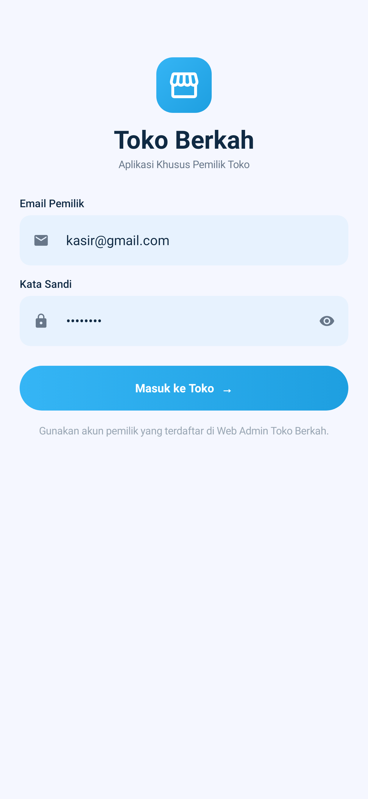
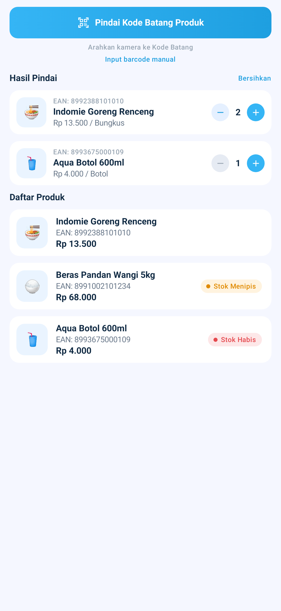
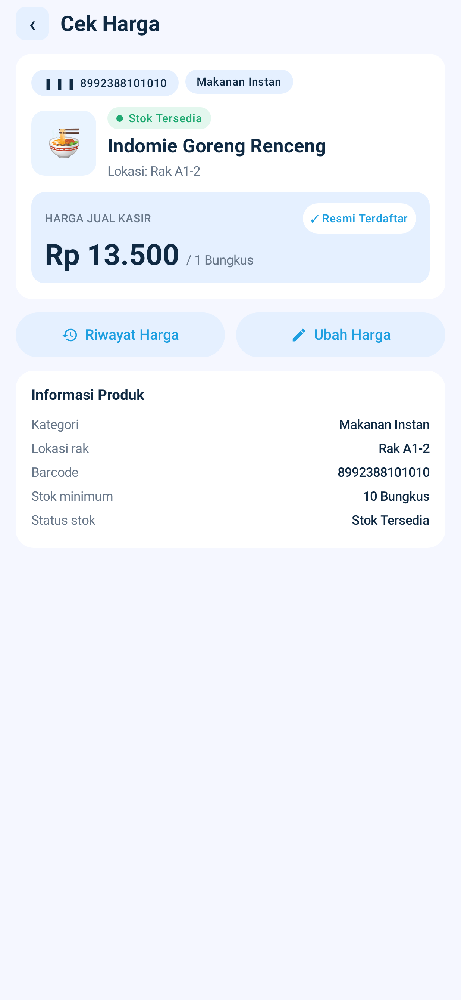
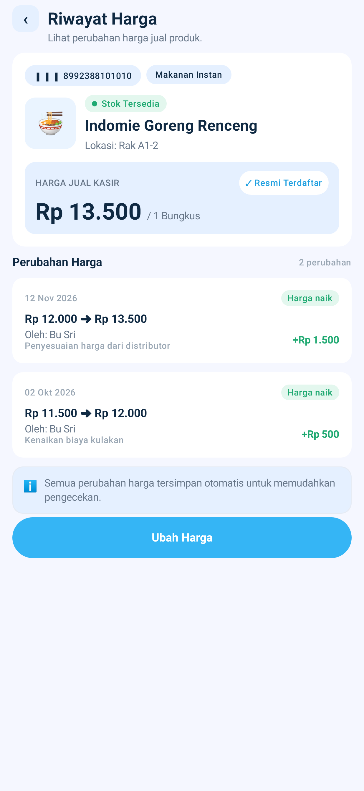
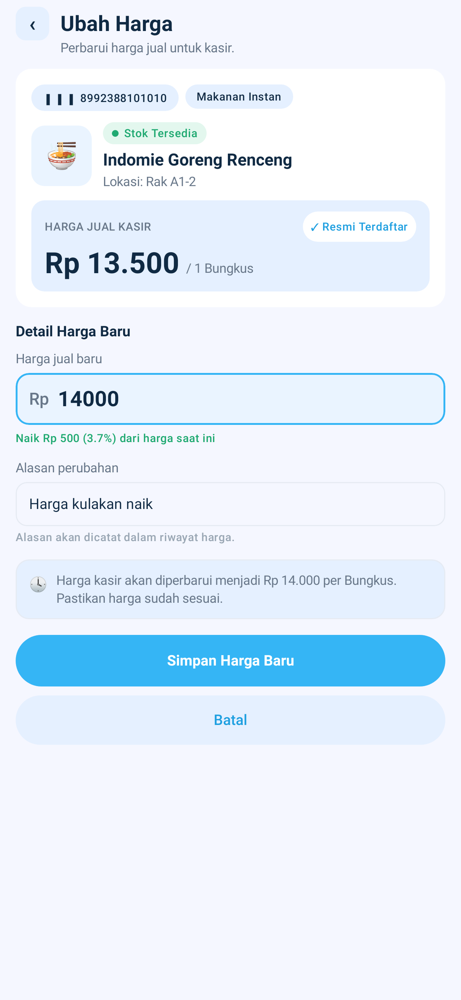
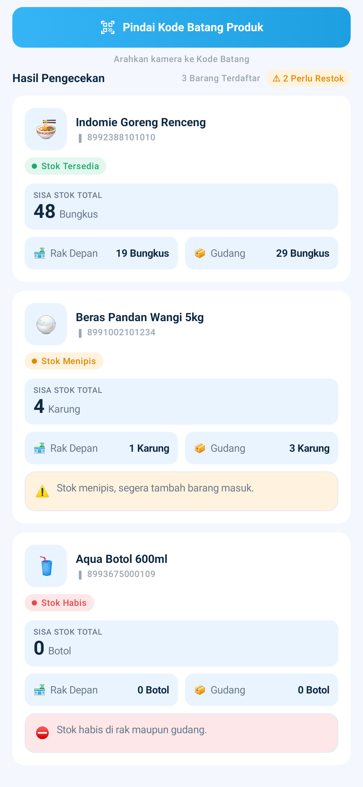
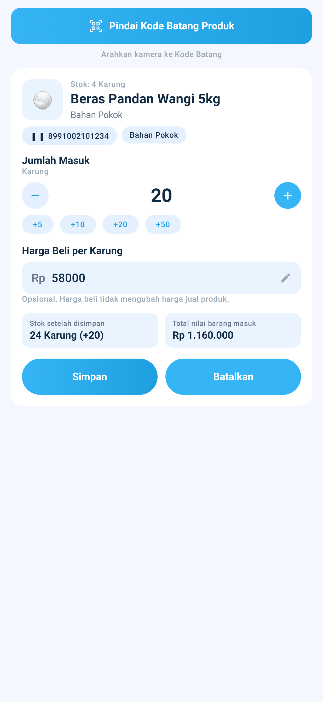

# 📱 Demo Aplikasi Android — Toko Berkah Owner

Aplikasi Android **khusus pemilik toko** (Kotlin + Jetpack Compose + Supabase).
Semua gambar di bawah adalah **tangkapan layar asli** dari aplikasi, dihasilkan
otomatis dari Composable-nya sendiri (bukan mockup).

| # | Halaman | Fungsi |
|---|---|---|
| 1 | Login | Akun demo `kasir@gmail.com` sudah terisi otomatis, tinggal tekan Masuk |
| 2 | Cek Harga | Pindai barcode → harga jual muncul, bisa ubah jumlah |
| 3 | Detail Produk | Harga, stok, rak, dan tombol Riwayat / Ubah Harga |
| 4 | Riwayat Harga | Semua perubahan harga + alasan & selisih |
| 5 | Ubah Harga | Input harga baru + alasan wajib, ada konfirmasi |
| 6 | Cek Stok | Status stok, sisa total, rak depan vs gudang |
| 7 | Barang Masuk | Catat barang datang, hitung total nilai otomatis |

---

## 1. Login


## 2. Cek Harga
Pindai barcode, harga langsung terlihat. Produk hasil pindai bisa ditambah/kurang jumlahnya.


## 3. Detail Produk


## 4. Riwayat Harga
Setiap perubahan harga tercatat lengkap dengan alasan, pelaku, dan selisih.


## 5. Ubah Harga
Alasan perubahan wajib diisi agar riwayat harga bisa dipertanggungjawabkan.


## 6. Cek Stok
Ringkasan "N Barang Terdaftar" + "M Perlu Restok", dipisah rak depan dan gudang.


## 7. Barang Masuk
Total nilai barang masuk dihitung otomatis dari harga beli × jumlah.


---

## Cara mencoba aplikasinya

Aplikasi Android **tidak bisa dijalankan langsung di browser** seperti versi
Desktop (`Kasir.exe`) atau versi Web. Untuk mencobanya di HP:

1. Unduh [`apk/TokoBerkah-Owner-arm64-v8a-debug.apk`](../TokoBerkah-Android-Owner/apk/TokoBerkah-Owner-arm64-v8a-debug.apk)
   (27 MB). Bila HP Anda 32-bit, pakai varian `armeabi-v7a`.
2. Pindahkan ke HP Android, lalu ketuk file-nya
3. Izinkan **"Instal dari sumber tidak dikenal"** bila diminta
4. Login dengan **`kasir@gmail.com`** / **`kasir123`** — form sudah terisi otomatis,
   cukup tekan **Masuk ke Toko**

Butuh versi lebih kecil? APK release hanya **8.1 MB** karena R8 membuang kode
yang tidak dipakai — tetapi masih *unsigned*, jadi harus ditandatangani dulu
sebelum bisa dipasang.

## Cara membuat ulang tangkapan layar di atas

Gambar-gambar ini dihasilkan dari kode aplikasi, jadi selalu ikut terbarui saat
tampilan diubah. Tidak perlu emulator:

```bash
cd TokoBerkah-Android-Owner
./gradlew testDebugUnitTest --tests "*ScreenshotTest*"
```

Hasilnya ditulis ke folder `docs/screenshots/`.
Proses ini sekaligus menguji bahwa setiap layar benar-benar bisa dirender
tanpa error.
